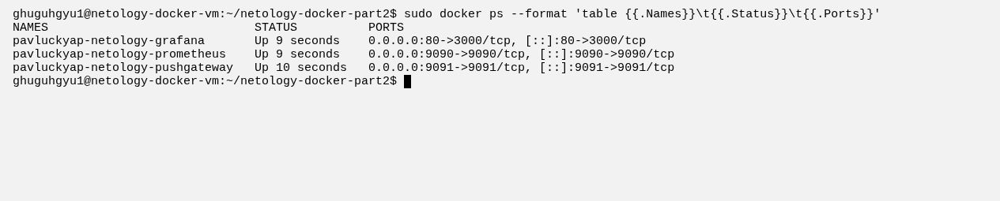
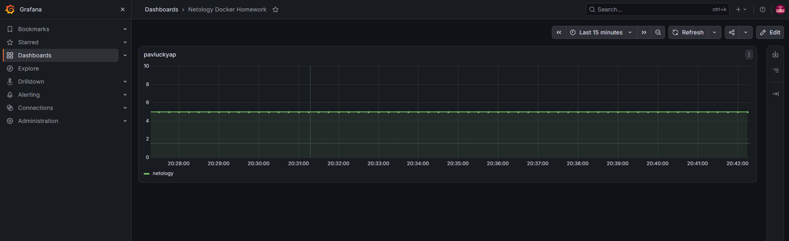
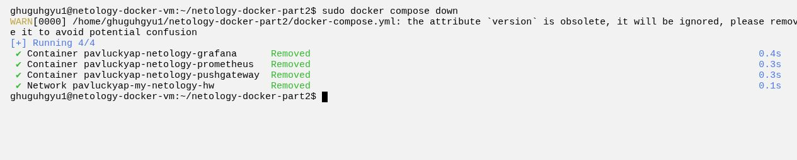

# 6.4. Docker. Часть 2 — Artem Pavlucky

## Задание 1

Docker Compose позволяет описать несколько сервисов в одном YAML-файле и управлять ими вместе. В поддержке я могу одной командой поднять стенд из Prometheus, Pushgateway и Grafana, воспроизвести проблему и после проверки остановить все три сервиса.

## Задание 2

Первичная конфигурация сети и томов до добавления сервисов приведена в [compose-step-2.yml](compose-step-2.yml).

На скриншотах показан первоначальный запуск с префиксом `pavluckyap`. После уточнения инициалов Артёма Дмитриевича в файлах проекта префикс исправлен на `pavluckyad`. Повторный запуск с исправленным именем ещё не проверен.

## Задания 3–6

[Полный docker-compose.yml](docker-compose.yml) задаёт общую сеть, постоянные тома и порядок запуска: Pushgateway, затем Prometheus и Grafana. Стенд запущен командой `sudo docker compose up -d`. Pushgateway доступен на порту 9091, Prometheus — на 9090, порт 80 — на порт 3000 контейнера Grafana.



## Задание 7

Команда для отправки метрики с исправленными инициалами:

```bash
printf 'pavluckyad 5\n' | curl --data-binary @- http://localhost:9091/metrics/job/netology
```

Grafana использует источник данных `http://prometheus:9090`. На снимке запрос `pavluckyap` вернул 5. При повторном запуске для панели нужен запрос `pavluckyad`.



## Задание 8

Команда `sudo docker compose down` удалила три контейнера и сеть проекта. Именованные тома сохранились.



## Повторный запуск

Скопируйте `.env.example` в `.env` рядом с `docker-compose.yml` и укажите в `GRAFANA_ADMIN_PASSWORD` учебный пароль из задания 5. Затем выполните `sudo docker compose up -d`.
